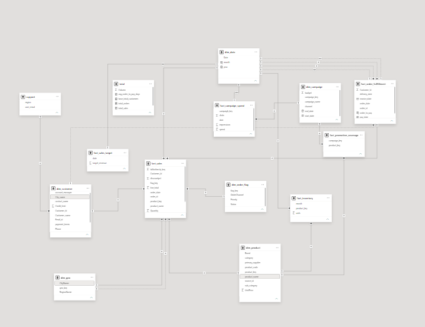
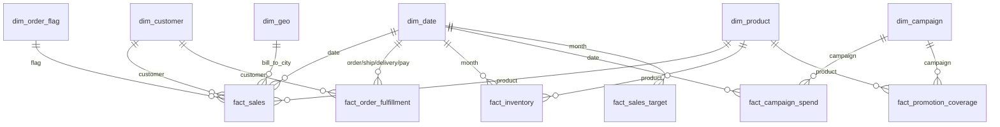

# Powebi-datamodeling-project
Power BI data modeling: from a 23-table mess to a clean Galaxy schema.
# Power BI Data Modeling


Refactoring an unoptimized **23-table dataset** into a clean, performant **Galaxy (multi-fact Star) Schema** in Power BI.

**Author:** Muhammed Ajmal M C · [LinkedIn](https://www.linkedin.com/in/mdajmalakd)

---

## 1. Problem Statement

The raw data arrives as 23 loosely related tables exported from different systems (sales, orders, invoices, payments, shipments, inventory, campaigns, targets, security). Loading them as-is causes:

- Slow report interactions
- Refresh timeouts
- Bloated `.pbix` size
- Convoluted DAX
- Double-counted or ambiguous numbers

This project shows how dimensional modeling fixes each of these.

## 2. Model Overview

**Result:** 6 dimensions + 6 facts + 2 support tables sharing conformed dimensions.

| Layer | Tables |
|---|---|
| Dimensions | `dim_customer`, `dim_product`, `dim_date`, `dim_geo`, `dim_campaign`, `dim_order_flag` |
| Facts | `fact_sales`, `fact_order_fulfillment`, `fact_inventory`, `fact_campaign_spend`, `fact_promotion_coverage`, `fact_sales_target` |
| Support | `support` (security mapping for RLS), `total` (measures table) |



### Special table patterns used

| Pattern | Table | Why |
|---|---|---|
| Junk dimension | `dim_order_flag` | Combines low-cardinality Channel, Priority, Status |
| Factless fact | `fact_promotion_coverage` | Records which products a campaign promoted, with no numeric measure |
| Accumulating snapshot | `fact_order_fulfillment` | Tracks order, ship, delivery, invoice and payment dates in one row |
| Periodic snapshot | `fact_inventory` | Monthly stock levels |
| Role-playing dimension | `dim_date` | Joined multiple times (order, ship, delivery, invoice, payment) |
| Snowflake flattened | `dim_geo` | Address, city and region merged |

## 3. Before vs. After

**Before (23 raw tables):** 

**After:** galaxy schema.




## 4. Power Query Standards

- Folder groups: `01_Stage`, `02_Dimensions`, `03_Facts`, `04_Support`
- Stage queries have **Enable load** turned off
- `snake_case` names, prefixes `dim_` and `fact_`, surrogate keys end in `_key`
- Cleaning: remove unneeded columns (`hash_key`, `source_id`, notes), deduplicate, unpivot, split delimiters, append yearly tables

## 5. DAX

Measures live in the `total` table. Reference code: [dax/measures.dax](dax/dax).

KPIs on the report: Total Sales, Total Orders, Active Customers, Total Customers, Avg Order-to-Pay Days.

## 6. Security (RLS)

Dynamic row-level security with `USERPRINCIPALNAME()` and the `support` mapping table (user email to region). 

## 7. Repository Structure

```
.
├── README.md
├── LICENSE
├── .gitignore
├── data/
│   ├── raw/raw_tables.xlsx        # 23 source tables
├── docs/
│   └── images/                    # screenshots
├── dax/
│   └── measures.dax
└── power-bi-template/
    └── ultimate_project.pbix
```

## 8. How to Run

1. Clone the repo.
2. Open `power-bi-template/ultimate_project.pbix` in Power BI Desktop.
3. If the refresh fails: **Transform data → Data source settings** and point the source to your local `data/raw/raw_tables.xlsx`.
4. Click **Refresh**.
5. Open **Model view** to see the schema, and **Manage roles** to test RLS with *View as*.

## 9. Build Steps (summary)

1. Load all 23 sheets into `01_Stage`, with load disabled.
2. Clean each stage query (types, trim, remove duplicates).
3. Build dimensions with surrogate keys.
4. Build facts at a clear grain, keeping only keys and numeric measures.
5. Create one-to-many, single-direction relationships (dimension to fact).
6. Create a date table and inactive relationships for role-playing dates.
7. Add measures to `total`.
8. Add RLS roles and test.
9. Build the report page.

## 10. Key Learnings

- Decide the **grain** before building any table.
- Never join fact to fact. Use shared dimensions.
- Single-direction filters avoid ambiguity.
- Keep measures in one table.
- Clean in Power Query, not in DAX.

## 11. License

MIT. See [LICENSE](LICENSE).

## 12. Connect

Muhammed Ajmal M C · https://www.linkedin.com/in/mdajmalakd
